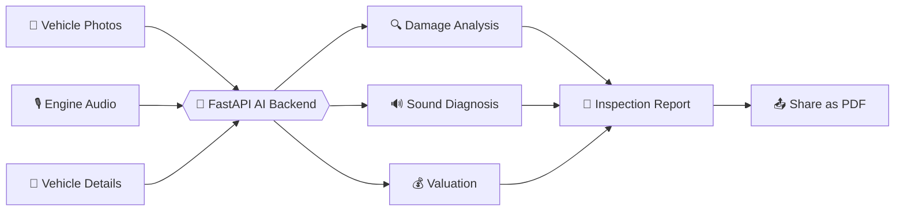

<!-- ============================================================ -->
<!--                      AutoDoc AI – README                     -->
<!-- ============================================================ -->

<div align="center">


<a href="https://git.io/typing-svg">
  
</a>

<br/>


<br/>

**[✨ Features](#-features) • [🔄 How It Works](#-how-it-works) • [🛠️ Tech Stack](#️-tech-stack) • [🚀 Quick Start](#-quick-start) • [📁 Structure](#-project-structure) • [🧪 Demo Mode](#-demo-mode)**

</div>

<br/>

---

## 🎯 What is AutoDoc AI?

> **Buying, selling, or insuring a vehicle shouldn't rely on guesswork.**

**AutoDoc AI** is a cross-platform **Flutter** app that turns your phone into a smart vehicle inspector. Upload photos of a vehicle, add an optional engine recording, and the app sends everything to a **FastAPI** backend where AI models analyze visible damage and engine sound. The results come back as a clean, structured inspection report you can export and share as a **PDF**.

<div align="center">



</div>

---

## ✨ Features

<table>
<tr>
<td width="50%" valign="top">

### 📸 Visual Damage Detection
Upload **1–6 JPEG/PNG photos** and let the damage model assess the vehicle's condition from every angle.

</td>
<td width="50%" valign="top">

### 🎙️ Engine Sound Analysis
Add an optional **10–15 second recording** (WAV, MP3, M4A/AAC, FLAC, OGG) to check for abnormal engine sounds.

</td>
</tr>
<tr>
<td width="50%" valign="top">

### 📄 Instant PDF Reports
Generate a structured, professional inspection report and **share it in one tap**.

</td>
<td width="50%" valign="top">

### 🛡️ Honest Results
If a model output isn't available, the report **marks it unavailable** — it never invents a valuation or audio diagnosis.

</td>
</tr>
<tr>
<td width="50%" valign="top">

### 🧱 Clean Architecture
Scalable, testable, feature-first structure with dependency injection and BLoC state management.

</td>
<td width="50%" valign="top">

### 🌍 Truly Cross-Platform
One codebase for **Android, iOS, Web, and Windows desktop**.

</td>
</tr>
</table>

---

## 🔄 How It Works

<div align="center">

| Step | Action | What Happens |
|:---:|:---|:---|
| **1️⃣** | **Enter details** | Fill in the vehicle information on the report form |
| **2️⃣** | **Add media** | Attach 1–6 photos and (optionally) an engine recording |
| **3️⃣** | **Analyze** | The app submits to the FastAPI `/api/v1/inspection` endpoint |
| **4️⃣** | **Review** | See damage, audio, and valuation results in a clear report |
| **5️⃣** | **Share** | Export the report as a PDF and send it anywhere |

</div>

> 💡 **Graceful by design:** With the car damage model installed, photo analysis works even when the price or audio models are missing. Engine audio stays optional when no audio model is installed.

---

## 🛠️ Tech Stack

<div align="center">

| Layer | Technology |
|:---|:---|
| 📱 **Framework** | [Flutter](https://flutter.dev/) |
| 💬 **Language** | Dart |
| 🧭 **Routing** | [GoRouter](https://pub.dev/packages/go_router) |
| 💉 **Dependency Injection** | [GetIt](https://pub.dev/packages/get_it) + [Injectable](https://pub.dev/packages/injectable) |
| 🧠 **State Management** | [flutter_bloc](https://pub.dev/packages/flutter_bloc) |
| ➕ **Functional Utilities** | [dartz](https://pub.dev/packages/dartz) |
| ⚡ **Backend** | FastAPI (see [backend/README.md](./backend/README.md)) |

</div>

---

## 🚀 Quick Start

### 📋 Prerequisites

- ✅ [Flutter SDK](https://flutter.dev/docs/get-started/install)
- ✅ Git
- ✅ VS Code or Android Studio
- ✅ The FastAPI backend running (see [backend/README.md](./backend/README.md))

### ⚡ Install & Run

```bash
# 1. Clone the repository
git clone https://github.com/SahanRathnaweera/AutoDoc-AI-.git
cd AutoDoc-AI-

# 2. Install dependencies
flutter pub get

# 3. Run the app
flutter run -d chrome
```

### 🌐 Connecting to the Backend

The app picks a sensible default API URL for each platform:

| Platform | Default API URL |
|:---|:---|
| 🌐 Web · 🖥️ Windows · 🍎 iOS Simulator | `http://127.0.0.1:8000` |
| 🤖 Android Emulator | `http://10.0.2.2:8000` |
| 📱 Physical Device | Use your computer's **LAN IP** |

Override it any time with:

```bash
flutter run --dart-define=API_BASE_URL=http://<your-backend-url>:8000
```

> ⚙️ Audio format support depends on the decoders installed on the backend. Configure any models and API keys you need — details are in [backend/README.md](./backend/README.md).

### 🔧 Optional Code Generation

```bash
flutter pub run build_runner build --delete-conflicting-outputs
```

---

## 🧪 Demo Mode

Want to explore the report and PDF screens **without trained models**? Turn on **Demo mode (simulated output)** in the report form.

> ⚠️ **Heads up:** Demo mode generates random placeholder valuation and audio values, and clearly labels the report and PDF as **simulated**. It does **not** analyze your uploaded media and must **never** be used for real vehicle decisions.

---

## 📁 Project Structure

```text
AutoDoc-AI-
├── 📱 android/
├── 🍎 ios/
├── 🎯 lib/
│   ├── ⚙️  config/
│   │   └── injection.dart        # GetIt + Injectable setup
│   ├── 🧱 core/
│   │   ├── error/                # Failure handling
│   │   ├── router/
│   │   │   └── app_router.dart   # GoRouter navigation
│   │   └── utils/
│   ├── 🧩 features/              # Feature modules
│   └── main.dart
├── 🧪 test/
├── 🌐 web/
├── 🖥️ windows/
├── analysis_options.yaml
├── pubspec.yaml
└── README.md
```

---

## 🌿 Git Workflow

| Branch | Purpose |
|:---|:---|
| `main` | 🟢 Production-ready stable branch |
| `dev` | 🟡 Active development branch |
| `feature/<name>` | 🔵 Feature-specific work |

```bash
git checkout dev
git pull origin dev
git checkout -b feature/your-feature-name
```

Commit, push, and open a pull request targeting **`dev`**.

---

## 🔮 What's Next?

Ideas for future versions:

- [ ] 🔐 Authentication and cloud sync
- [ ] 🗂️ Inspection history across devices
- [ ] 📊 Side-by-side report comparison
- [ ] 🌍 Multi-language reports

---

## 🤝 Contributing

Contributions, issues, and feature requests are welcome! Fork the repo, create a feature branch from `dev`, and open a pull request.

---

<div align="center">

### ⭐ If AutoDoc AI helped you, give it a star!

**Built with 💙 using Flutter & FastAPI**


</div>
